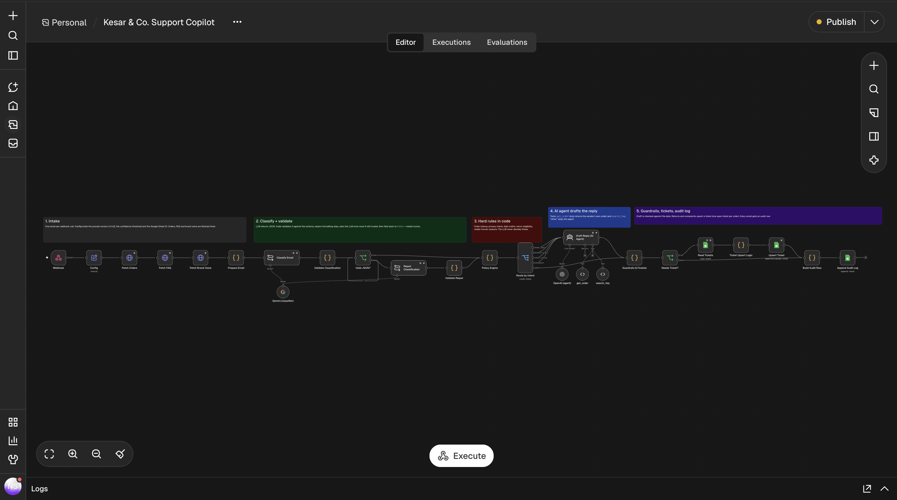

# Kesar & Co. Support Copilot — Nitesh Sharma

## 1. Summary

- **What I built:** an n8n workflow that takes one support email per webhook call, classifies it with an LLM into the required JSON, applies the business rules in code (order lookup, privacy, return eligibility, needs-human), lets an AI agent with two tools draft the reply, upserts a ticket for returns and complaints, and writes one audit row per email to Google Sheets.
- **Platform and LLMs:** n8n Cloud (trial). Classifier: Google Gemini 2.5 Flash, temperature 0. Reply-drafting agent: OpenAI gpt-5-mini, reasoning effort low. Both run on n8n's built-in AI gateway credits, so no API keys are stored anywhere. I started with Gemini for both; why the agent moved to OpenAI is in `TEST_REPORT.md` section 4.
- **Time spent:** about 3.5 hours, including account setup, both test runs and the write-up.
- **Links:** [Google Sheet](https://docs.google.com/spreadsheets/d/14uz7z-TBI9m4w1qoEyQqLWwFDD-tvAIICsP-F21Kygo/edit?usp=sharing) · Screen recording: TODO add the Loom link · Screenshots: [workflow](./screenshots/workflow.png), [tickets](./screenshots/tickets.png), [audit log](./screenshots/audit_log.png)
- **What works / what doesn't:** In the final v2 run all 25 emails got the right intent and the right action (ticket, needs-human, eligibility decision), 9 tickets with no duplicates, and I found no invented facts when reading the drafts. The v1 baseline got every intent right too but only 3/12 actions, mainly because it relied on model confidence, which was 0.90–0.98 on every email. Still weak: confidence is useless as a signal, one draft (E05) misses the customer's travel date, and the agent cannot use Gemini in n8n (details in `TEST_REPORT.md`).

Design principle: **the LLM reads and writes; code decides.** Anything that would be costly to get wrong (who may see an order, whether a return is eligible, whether a human must look) is an explicit check in a Code node, so an email cannot talk the system out of it.

## 2. Architecture



```
Webhook → Config → Fetch Orders / FAQ / Brand Voice → Prepare Email
  → Classify Email (LLM) → Validate Classification ─ valid ──────────────┐
                                   └ invalid → Repair (LLM) → Validate Repair (fallback) ┤
  → Policy Engine → Route by Intent ─ order_status / product_query / return_refund / complaint → Draft Reply (AI Agent: get_order, search_faq) ┐
                                    └ other ──────────────────────────────────────────────────────────────────────────────────────────────────┤
  → Guardrails & Finalize → Needs Ticket? ─ yes → Read Tickets → Ticket Upsert Logic → Upsert Ticket ┐
                                          └ no ──────────────────────────────────────────────────────┤
  → Build Audit Row → Append Audit Log
```

| Step / node | What it does | Why I designed it this way |
|---|---|---|
| Webhook | Receives one email (POST), answers when the run finishes | The sender script waits for each response, so emails are processed one at a time. That keeps ticket de-duplication free of race conditions. |
| Config | Prompt version (`v1`/`v2`), confidence threshold, Google Sheet ID, data URLs | One place to switch versions and thresholds; nothing secret lives here. |
| Fetch Orders / FAQ / Brand Voice | HTTP GET of the three data files | Treats them as external APIs; a policy change in `faq.md` needs no workflow edit. |
| Prepare Email | Normalises the payload, finds `KC-####` IDs by regex, flags prompt-injection patterns and photo attachments, builds the classifier prompt | Cheap deterministic signals that later checks can trust more than model output. |
| Classify Email | Gemini 2.5 Flash returns the JSON from `schemas/llm_output.schema.json` plus extra fields (`issue_type`, `product_condition`, `medical_question`, …) | The extra fields give the rule engine the facts it needs without a second LLM call. |
| Validate Classification → Repair → Validate Repair | Parses, repairs formatting slips in code, validates every field against the schema; if still invalid asks the LLM once to fix it; if that fails, falls back to `other`, confidence 0, needs human | Three layers (repair, retry, fall back) so the pipeline never stops on bad JSON and never guesses an intent. |
| Policy Engine | Order lookup (by ID, else by sender email), privacy check, days since delivery from `received_at`, return/defect eligibility, needs-human reasons, ticket priority, and the brief for the agent | Hard rules in code. The agent is told the decision; it only words it. |
| Route by Intent | Five outputs. Four go to the agent, `other` skips it | `other` needs no customer reply, so it costs no agent call. |
| Draft Reply (AI Agent) | Tools agent with `get_order` and `search_faq`; decides which to call | `get_order` takes the sender address from the workflow, not from the model, so it cannot return someone else's order. `search_faq` returns matching FAQ sections verbatim. |
| Guardrails & Finalize | Checks the draft: links, rupee amounts and order IDs must exist in the order or FAQ; no "refund approved" unless the order record says so; no leaked details when access was denied; medical wording flagged | A second line of defence after the prompt. A failed check sets needs-human with the reason; a privacy leak replaces the draft. |
| Read Tickets → Ticket Upsert Logic → Upsert Ticket | Finds an open ticket for the order; updates it (adds email ID and a note) or creates one | "Append or Update" matched on `ticket_id` means one node handles both cases. |
| Build Audit Row → Append Audit Log | One row per email, template columns plus `needs_human_reason`, `decision_code`, `tools_called`, `json_valid_first_try`, `approx_tokens`, `summary` | The extra columns make each decision explainable from the sheet alone. |

Sheet writes use raw cell format, so text from an email can never be interpreted as a spreadsheet formula.

## 3. Setup — how someone else can run this

1. **Accounts / credentials (no keys in this repo):**
   - n8n (Cloud trial or `npx n8n`).
   - LLMs: on n8n Cloud, the Gemini and OpenAI model nodes can use n8n's "Gateway credits" with no key. Elsewhere, create a *Google Gemini(PaLM) Api* credential (AI Studio key) and an *OpenAI* credential.
   - Google account → n8n credential type *Google Sheets OAuth2*.
2. **Google Sheet:** create a sheet named `Kesar Support` with two tabs, `Audit Log` and `Tickets`. Import `templates/audit_log_headers.csv` and `templates/tickets_headers.csv` as their header rows (the assignment's columns, plus my extra audit columns at the end).
3. **Import the workflow:** n8n → Workflows → Import from File → `workflow/kesar_support_copilot.json`.
4. **Configure:**
   - `Config` node: paste the Google Sheet ID (the part of the sheet URL between `/d/` and `/edit`) into `GOOGLE_SHEET_ID`.
   - `Gemini (classifier)` and `OpenAI (agent)`: select Gateway credits (or your own credential). If a model is not offered, pick the closest current Flash / mini model.
   - `Read Tickets`, `Upsert Ticket`, `Append Audit Log`: select the Google Sheets credential.
5. **Run the 25 test emails:** activate (publish) the workflow, copy the Webhook node's production URL, then:
   ```bash
   python scripts/send_test_emails.py --url <WEBHOOK_URL> --only E01,E07,E12 --timeout 180
   python scripts/send_test_emails.py --url <WEBHOOK_URL> --timeout 180 --delay 8
   ```
   For the v1 baseline, set `PROMPT_VERSION` to `v1` in `Config`, clear the `Tickets` tab, and send at least 10 emails. Set it back to `v2` and clear `Tickets` again before the final run.
6. **Rebuild after editing code or prompts:** `node scripts/build_workflow.js` regenerates the workflow JSON from `code/` and `prompts/`.
7. **Offline logic test (no LLM, no accounts):** `node scripts/simulate.js` runs the exact Code-node sources over all 25 emails with a stand-in classifier and checks 20 rule assertions.

## 4. Prompts

All prompts are in [`prompts/`](./prompts) and are embedded into the workflow by the build script.

| Prompt | File | Model settings |
|---|---|---|
| Classifier v2 (final) | [`classifier_v2.md`](./prompts/classifier_v2.md) | Gemini 2.5 Flash, temperature 0, max output 2048 tokens |
| Classifier repair | [`classifier_repair.md`](./prompts/classifier_repair.md) | same model |
| Agent system v2 (final) | [`agent_system_v2.md`](./prompts/agent_system_v2.md), with `brand_voice.md` inserted at run time | OpenAI gpt-5-mini, reasoning effort low, max 6 iterations |
| Classifier v1 / Agent v1 (baseline) | [`classifier_v1.md`](./prompts/classifier_v1.md), [`agent_system_v1.md`](./prompts/agent_system_v1.md) | same settings |

The agent's user message is built per email by the Policy Engine: the task, a `<system_facts>` block (received date, reply language, order-check result, days since delivery, the eligibility decision) and the email inside `<email>` tags marked as untrusted.

## 5. Key decisions and assumptions

- **Low confidence / needs human:** threshold **0.75** on the classifier's confidence. The runs showed confidence alone is close to useless (0.90–0.98 on every email, even "Where is it???"), so these force needs-human regardless of confidence: classification fallback, suspected prompt injection, angry sentiment, sender not matching the order, order ID not found, every complaint, every refused or unclear return decision, medical topics, a cancelled or overdue order, an order-status email with no order for the sender, "other" emails that still need an answer, and any guardrail hit on the draft. Clean order-status replies, FAQ answers and eligible standard returns are not flagged.
- **Duplicate tickets:** before writing, the workflow reads the Tickets tab and looks for a row with the same `order_id` whose status is not `Closed`. If found, it appends the new email ID and a dated note to that row and raises the priority if needed; otherwise it creates `TKT-<order digits>-<email id>`. Re-processing the same email does not add a second note.
- **Right customer only:** `lookupOrder()` returns an order only when the sender's address equals the order's `customer_email`. The same function backs both the Policy Engine and the `get_order` tool, and the sender address is read from the webhook, never from model output. On a mismatch the agent receives `ACCESS_DENIED` and no order data, and the guardrail replaces any draft that still contains that order's link, address or courier.
- **Grounded in the FAQ:** the agent can only get policy text through `search_faq`, which returns whole FAQ sections. The prompt forbids answering beyond them and requires a `[NEEDS_HUMAN: …]` first line when the FAQ does not cover a question; the guardrail then rejects links and amounts that are in neither the FAQ nor the order.
- **Other assumptions:**
  - "Within 48 hours" is checked as at most 2 calendar days after `delivered_date`, because orders carry dates, not times.
  - Used or opened products are refused under the hygiene rule even inside 7 days. Refusals are still drafted, but flagged for a human.
  - For defect reports the draft never promises a refund or replacement before a person has verified the photos.
  - Ineligible returns still get a ticket, since the assignment asks for one per return/refund.
  - Collaboration proposals are logged with a note to forward them to the partnerships address in the FAQ.
  - The return window (7 days) and defect window (2 days) are constants in `code/lib_shared.js` and must be kept in step with `faq.md`.

## 6. Scaling to 1,000 emails/day

- **First to break: LLM rate limits.** Free-tier quotas are far below 1,000 emails × about 3 calls. I would move to a paid tier, keep retry with backoff (already on the LLM and Sheets nodes, 3 tries), and put a queue between the webhook and the processing so bursts wait instead of failing.
- **Sequential processing.** The webhook answers only when a run finishes, which is safe but slow. With a queue and several workers, ticket de-duplication needs a real lock or a database unique key on open `order_id`.
- **Google Sheets as a database.** Reading the whole Tickets tab per ticket and appending rows will hit Sheets API quotas and get slow. I would move tickets and the audit log to Postgres (or a helpdesk tool) and keep the sheet as a view.
- **Refetching data per email.** Orders, FAQ and brand voice are fetched on every run. I would cache FAQ and brand voice and call a real order API per order ID.
- **Monitoring.** Add an error workflow with alerts, and a daily summary of needs-human rate, fallback rate, guardrail hits and cost.
- **FAQ search.** Keyword scoring over 9 sections is enough today; a much larger knowledge base would need embeddings.

## 7. Product-thinking questions

1. **Auto-send vs. draft.** I would auto-send only replies where a wrong answer is cheap and every fact is machine-checked: order-status replies where the order was found, the sender matches, the order is neither cancelled nor overdue, and the guardrails passed; and FAQ answers the agent grounded without escalating. Everything involving money, a refusal, a complaint, an angry customer, privacy, medical topics or suspected injection stays a draft. I set the confidence threshold at 0.75, but only as one of several gates, because a model can be confidently wrong. I would start with nothing auto-sent for two weeks, compare drafts with what the human actually sent, and unlock auto-send per category once edits fall below about 5%.

2. **Cost.** Measured, not estimated: the n8n gateway balance went from $2.00 to $1.86 over 43 workflow runs (12 v1, 25 v2, 6 test runs). That is about $0.0033 per email, roughly ₹0.28 at ₹85 per dollar. It covers one Gemini 2.5 Flash classification and, for 21 of the 25 emails, two or three gpt-5-mini agent turns with tool results. At 1,000 emails/day: 1,000 × $0.0033 ≈ $3.30/day, about $100 (₹8,300) a month before retries. Gateway prices may differ from buying the APIs directly, so I would re-measure with our own keys. Even doubled, it is far below one support salary, so I would spend on accuracy before cutting cost; the first saving would be answering simple order-status emails from a template without the agent.

3. **Success metric.** Week 1: the share of drafts the human sends with no edits or only cosmetic ones, per intent. It measures whether the copilot saves time and whether it is right. I would switch it off immediately on any privacy leak, any invented order fact or policy reaching a customer, or any wrongly promised refund; and pause it if the unedited rate stays under about 60% or the human spends longer reviewing than writing.

4. **Failure experience.** In draft mode a wrong draft costs the agent's time, not the customer's trust, because nothing is sent unreviewed. The risky failures are a wrong classification that hides an urgent complaint among routine mail, and a plausible but wrong draft that a rushed agent approves. I limit damage by flagging with a stated reason, never stating refunds as approved, falling back to a neutral holding reply when unsure, keeping a full audit row per email, and writing a ticket for every return and complaint so nothing depends on the draft alone.

5. **Don't automate.** The refund or replacement decision for damaged, wrong or missing items. It needs someone to look at photos, judge whether the claim is genuine, and sometimes make a goodwill exception. A wrong automated yes costs money and invites abuse; a wrong automated no loses a customer who was right. The copilot should prepare the case (order facts, policy window, photos received or not) and let a person decide.

## 8. How I used AI tools

- **Claude Code (in VS Code) was my main tool, used as a pair programmer.** It wrote most of the Code-node JavaScript, the prompts, the script that assembles the n8n workflow JSON, the offline simulator (`scripts/simulate.js`), and the first drafts of this README and the test report. Before I connected real accounts, it ran the workflow in a local n8n against a mock model to check the wiring.
- **I connected Claude Code to my n8n Cloud instance through n8n's MCP server.** Through it, Claude changed the model nodes, published versions, sent the test emails, read the execution data to find the three problems in `TEST_REPORT.md` section 4, and pushed the fixes. It also checked that every Code node in n8n matched this repo.
- **My part:** creating the n8n, Google and Sheet setup and the credentials, importing the workflow, clearing the sheet between the v1 and v2 runs, taking the screenshots, and reviewing the results and drafts. When the first Google Sheet was created in the wrong Google account, I had it removed and made my own.
- **What I take from it:** the bugs that mattered (Gemini rejecting parallel tool calls, the triple audit rows, E18 passing for the wrong reason) only showed up in live runs and by reading the output, not in the plan. I can explain every node and change any of it live.

## 9. If I had one more week

- Replace Google Sheets with a database and add a queue, so emails can be processed in parallel safely.
- Build a small review screen where the agent approves, edits or rejects a draft, and log the edits as the quality metric.
- Evaluate reply drafts automatically (grounding and tone checks) instead of reading 25 by hand.
- Record real token usage and cost per email from the API response rather than the character-based estimate.
- Handle photo attachments (confirm they exist and show the product) and multi-order customers.
- Add a date check to the guardrails (v1 invented "27 Nov" in E24, and nothing checks dates today) and pass the ETA's weekday to the agent so it can answer deadlines like E05's Monday trip.
- Replace the model's self-reported confidence with one computed from signals (order found, sender match, two classifier samples agreeing).
